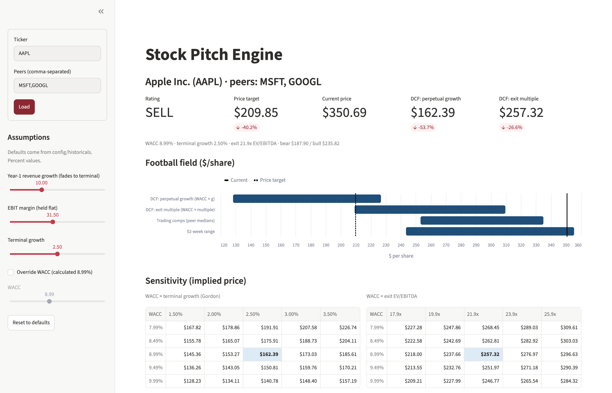

# Stock Pitch Engine

**Type a ticker, get an analyst-grade stock pitch in under a minute.**

```bash
uv run pitch AAPL --peers MSFT,GOOGL
```

From free public data (SEC filings + market prices), the engine builds:

- **A live Excel valuation model**: historicals, a discounted cash flow (DCF), trading comparables, sensitivity tables and a football-field chart. Every number is a real formula, so changing an assumption updates the whole model.
- **A one-page pitch memo** with the rating, price target, bull/base/bear cases and valuation summary already filled in. Only the narrative is left to write.
- **An interactive web app** where you move sliders for growth, margins and discount rate and watch the price target change.

Built for investment-club pitches and stock-pitch competitions. The goal is output that looks like analyst work, with every assumption traceable to a source.


<!-- TODO: add docs/screenshot.png (capture of `uv run pitch-ui` on AAPL) -->

**Highlights**
- Reads raw XBRL financial data from SEC EDGAR and normalizes inconsistent company tagging into standard financial statements.
- Two-method DCF (perpetual growth and exit multiple), CAPM-based WACC, mid-year discounting, and a full enterprise-to-equity bridge.
- The Excel model follows banker conventions (blue inputs, black formulas, no hard-coded numbers inside formulas).
- Every missing or estimated data point is flagged, never silently filled with zero.
- Reverse DCF: solves for the constant revenue growth and terminal EBIT margin the current price implies (in the JSON, a live Excel tab, the memo and the UI).
- Pure-Python valuation core with 61 unit tests, including hand-checked DCF cases.

---

## Quickstart

Requires Python 3.11+ and [`uv`](https://docs.astral.sh/uv/).

```bash
git clone <this repo> && cd stock-pitch-engine
uv sync
cp .env.example .env        # set EDGAR_USER_AGENT="Your Name you@example.com" (required by the SEC)
```

**CLI**

```bash
uv run pitch AAPL --peers MSFT,GOOGL
# Apple Inc. (AAPL): SELL, PT $210.00 vs $350.69 | bear $188.03 / bull $235.99 | WACC 8.99% | 5 data-quality flags
#   wrote outputs/AAPL/pitch_pack.json
#   wrote outputs/AAPL/model.xlsx
#   wrote outputs/AAPL/memo.md
```

**Web UI**

```bash
uv run pitch-ui
```

Enter a ticker and peers, then adjust Year-1 revenue growth, EBIT margin, terminal growth and (optionally) an override WACC. The implied price, football field and sensitivity grids update live. Download buttons export `model.xlsx` and `memo.md` built from the current slider settings.

**Tests**

```bash
uv run pytest
```

---

## Example output: Apple (AAPL)

Peers MSFT, GOOGL. Base year FY2026 (revenue $478.8B, net income $132.2B). Market data as of 2026-11-10.

| Output | Value |
|---|---|
| Current price | $350.69 |
| DCF: perpetual growth (g = 2.5%) | $162.50 (TV = 73% of EV) |
| DCF: exit multiple (21.9x EV/EBITDA, peer median) | $257.49 (TV = 83% of EV) |
| **Price target** (average of the two DCF prices) | **$210.00 (−40.1%)** |
| Bull / bear | $235.99 / $188.03 |
| **Rating** | **SELL** |
| WACC | 8.99% (cost of equity 9.07%, Blume-adjusted beta 1.06) |
| Revenue growth path | 10.0% → 8.1% → 6.3% → 4.4% → 2.5% |
| EBIT margin / tax rate | 31.5% (5-yr median) / 17.5% |

| Football field ($/share) | Low | High |
|---|---|---|
| DCF: perpetual growth (WACC × g) | $128.32 | $226.90 |
| DCF: exit multiple (WACC × multiple) | $209.35 | $309.83 |
| Trading comps (peer medians) | $253.11 | $334.94 |
| 52-week range | $243.42 | $355.38 |

How to read this: the default assumptions hold Apple's margin flat at its historical median and fade growth to 2.5%. On those assumptions the cash flows don't support today's price. Comps sit far closer to the market because the peers trade at premium multiples. That gap is the starting point for the pitch, not the conclusion. The UI makes it easy to test what growth and margin the current price implies.

---

## How the model works

### Pipeline

```
SEC EDGAR companyfacts ─┐
                        ├─► normalize ─► dcf + comps ─► pitch_pack.json ─┬─► model.xlsx  (excel.py)
yfinance market data  ──┘                                                ├─► memo.md     (memo.py)
config/assumptions.yaml ─────────────────────────────────────────────────┘   Streamlit UI (ui.py)
```

`pitch_pack.json` is the single source of truth. The Excel writer, memo filler and UI only read it, so the three outputs always agree.

### Normalization (`normalize.py`)
- Maps XBRL tags to 18 standard line items using an ordered fallback list per item. For example, revenue may be `Revenues`, `RevenueFromContractWithCustomerExcludingAssessedTax` or `SalesRevenueNet`, depending on the filer and year.
- Uses annual 10-K (FY) facts only and keeps the last 5 fiscal years.
- Every missing or derived value goes into a `data_quality` list with a reason.

### DCF (`dcf.py`)
- **Unlevered FCF** = EBIT·(1 − t) + D&A − capex − ΔNWC, projected 5 years.
- **Drivers** come from config if set, otherwise from historicals, clamped to sane bounds:
  - Revenue growth starts at the average of last-year growth and the 5-yr CAGR, then fades linearly to terminal growth.
  - EBIT margin is the 5-yr **median**, so one-off charges don't distort it.
  - Tax, capex, D&A and operating NWC use historical averages as % of revenue.
- **WACC**: CAPM cost of equity (risk-free rate + Blume-adjusted beta × ERP), after-tax cost of debt (interest / debt), and market-value weights. An optional override replaces the calculated WACC.
- **Terminal value**, two ways, both reported:
  - Gordon growth, with the implied exit multiple shown as a cross-check.
  - Exit EV/EBITDA at the peer median, with the implied perpetual growth shown as a cross-check.
- **Mid-year convention** toggle for cash-flow discounting.
- **Bridge**: EV − net debt (debt − cash − short-term investments), divided by diluted shares, gives the implied price and upside.

### Comps (`comps.py`)
EV/Revenue, EV/EBITDA, P/E (LTM), revenue growth and EBIT margin for each peer, with the median and mean. The target's implied price at the peer-median multiples forms the comps range.

### Sensitivities and scenarios
- 5×5 implied-price grids: WACC × terminal growth and WACC × exit multiple (step sizes set in config).
- **Base** = average of the two DCF prices = price target.
- **Bull / Bear** = one grid step toward or against value on both grids, averaged.
- **Rating**: BUY if upside ≥ +15%, SELL if ≤ −15%, otherwise HOLD (thresholds set in config).

### Excel model
Tabs: `Inputs` · `Historicals` · `DCF` · `Comps` · `Sensitivity` · `Summary`. All assumptions sit on `Inputs` in blue. Everything else is a formula referencing them, including the sensitivity grids and the football-field chart. Change WACC on `Inputs` and the `Summary` price target updates. Tests recompute the workbook formulas and check them against the Python math.

---

## Design decisions

- **Formulas, not pasted values.** A model a reviewer can't audit or flex is a screenshot. Every derived cell is a formula, and the test suite evaluates the workbook to prove it matches Python.
- **One JSON pack, many renderers.** Valuation logic lives in pure functions (dict in, dict out). Excel, the memo and the UI are thin layers over the pack, with no duplicated math. The UI rebuilds the pack from cached inputs on every slider move.
- **Flag, never fill.** Missing data is recorded with a reason instead of defaulting to zero. A silent zero in capex or debt can move a price target by double digits without anyone noticing.
- **Robust defaults with visible sources.** Median margins, Blume-adjusted beta, clamped drivers and a fading growth path. Every assumption carries a `source` string (e.g. "historical median 31.51% over 5y") that appears in the Excel `Inputs` tab.
- **Two terminal methods, reported side by side.** Perpetual growth and exit multiple usually disagree. Showing both, with each one's implied cross-check, puts that disagreement on the page.
- **Config over code.** All assumptions live in `config/assumptions.yaml`, and `config/<TICKER>.yaml` deep-merges per-ticker overrides.
- **Numbers by code, prose by a person (or a cheap LLM).** The memo template fills every number and leaves `[PROSE]` slots. Pasting `pitch_pack.json` into a model drafts the narrative, so the tool carries no API cost.
- **Free data, cached.** Every EDGAR and yfinance response is cached to `cache/` by ticker and date, so re-runs are instant and cost nothing.

## Data sources

| Data | Source |
|---|---|
| Ticker → CIK, SIC code | `sec.gov/files/company_tickers.json`, EDGAR submissions |
| Financial statements | SEC EDGAR XBRL `companyfacts` API (10-K, FY) |
| Price, market cap, shares, beta, 52-week range | `yfinance` |
| Risk-free rate, ERP, thresholds | `config/assumptions.yaml` |

The SEC requires a descriptive `User-Agent` (name + email). It is read from `.env` and never hardcoded.

## Limitations

- **Out of scope:** banks and insurers (detected by SIC code; the tool exits with a message because FCFF DCF doesn't apply), non-US filers (20-F), quarterly data, and any paid data.
- **Annual data only.** "LTM" comps use the latest fiscal year, so they can lag by up to a year.
- **Book debt stands in for market debt** in WACC weights. Leases, minorities, pensions and preferred stock are not in the bridge.
- **Mechanical defaults.** Historical medians and a linear growth fade are a starting point, not a forecast. High-growth or cyclical companies (e.g. NVDA) need explicit overrides.
- **yfinance is unofficial** and can change or rate-limit. Beta is a raw regression beta (Blume-adjusted).
- **The memo needs a human.** Thesis, catalysts and risks are left as `[PROSE]` slots by design.

## Repo layout

```
pitch/
  data/edgar.py, market.py, cache.py   # fetch + cache
  normalize.py                         # XBRL tags -> standard 5-yr IS / BS / CF
  dcf.py                               # drivers, WACC, FCFF DCF, terminal values, sensitivities
  comps.py                             # peer multiples
  pack.py                              # fetch_inputs + assemble -> pitch_pack.json
  excel.py                             # model.xlsx with live formulas + football field chart
  memo.py                              # scenarios, rating, memo template fill
  cli.py                               # `pitch`
  ui.py                                # `pitch-ui` (Streamlit)
config/assumptions.yaml                # global assumptions; config/<TICKER>.yaml overrides
templates/memo.md
tests/
outputs/<TICKER>/                      # model.xlsx, pitch_pack.json, memo.md (gitignored)
```
